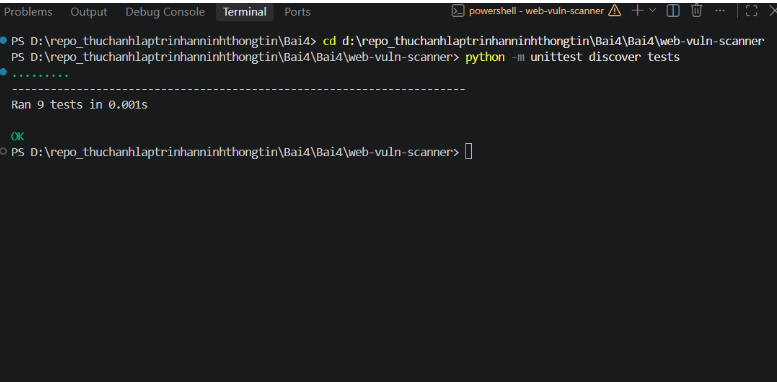
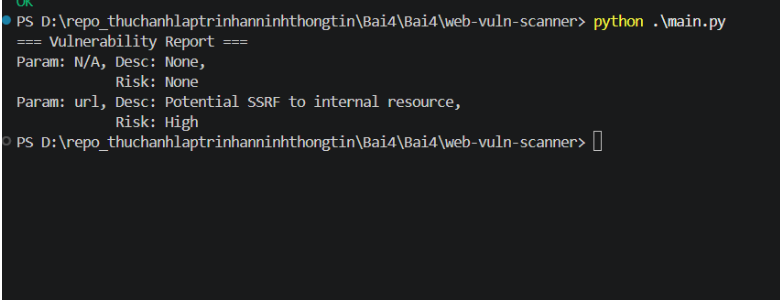
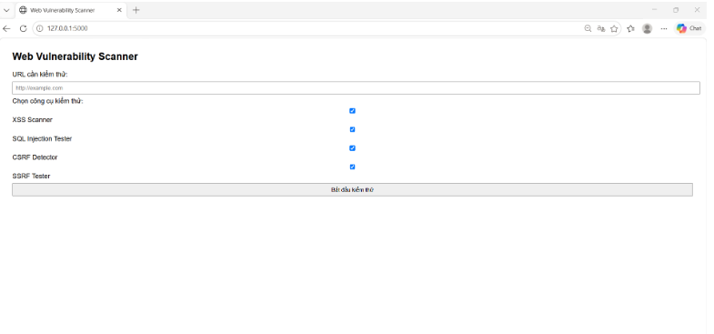
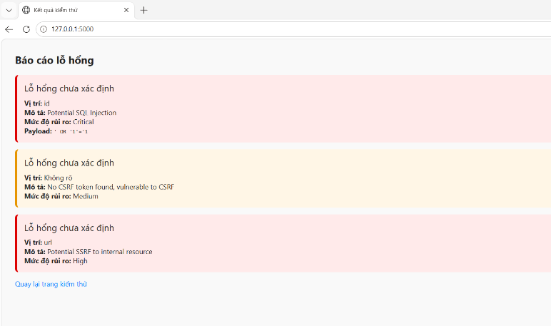
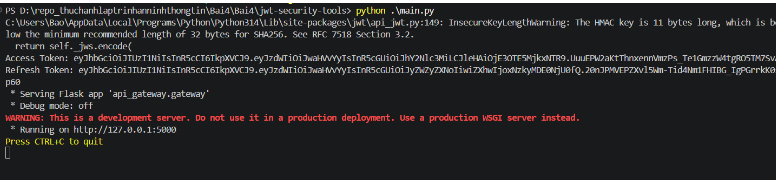
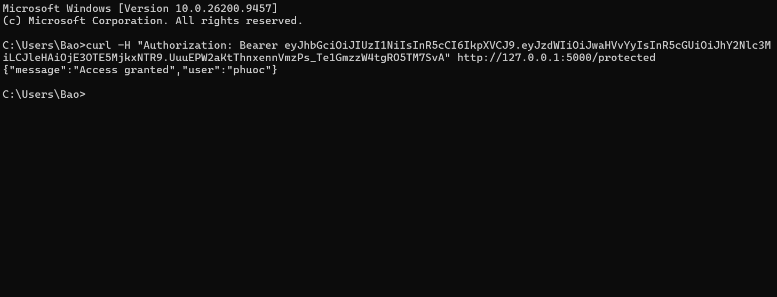

# TRƯỜNG ĐẠI HỌC CÔNG NGHỆ TP HCM

## KHOA CÔNG NGHỆ THÔNG TIN

### Môn: Thực hành lập trình an ninh thông tin

---

# BÁO CÁO

- **Họ Và Tên:** Phan Gia Bảo
- **MSSV:** 2380600167
- **Lớp:** 23DATA1

---

# BÁO CÁO BÀI 4: BẢO MẬT WEB APP VÀ API

---

## PHẦN 1: WEB VULNERABILITY SCANNER (`web-vuln-scanner`)

### 1. Ảnh 1: Chạy kiểm thử tự động Unittest

!

- **Lệnh thực thi:**
  ```powershell
  cd d:\repo_thuchanhlaptrinhanninhthongtin\Bai4\Bai4\web-vuln-scanner
  python -m unittest discover tests
  ```
- **Giải thích chi tiết:**
  - Hệ thống thực hiện chạy toàn bộ 9 test cases tự động cho các module phát hiện lỗ hổng bảo mật:
    - `test_csrf.py`: Kiểm tra tính năng nhận diện token chống CSRF (`csrf_token`, `_csrf`, `csrfmiddlewaretoken`) và phát hiện form thiếu token.
    - `test_sql_injection.py`: Kiểm tra khả năng nhận diện các biến thể payload SQL Injection phổ biến (như `' OR '1'='1`, `UNION SELECT`,...).
    - `test_ssrf.py`: Kiểm tra khả năng phát hiện địa chỉ IP nội bộ, loopback (`127.0.0.1`, `localhost`, các dải IP Private Class A/B/C) trong tham số URL.
    - `test_xss.py`: Kiểm tra cơ chế gửi payload reflected XSS (`<script>alert(1)</script>`, `svg/onload`) và nhận diện phản hồi có chứa mã độc.
    - `test_report.py`: Kiểm tra tính năng tổng hợp dữ liệu lỗ hổng thành báo cáo chuẩn hóa dạng Dictionary/List.
  - **Kết quả:** `Ran 9 tests in 0.001s - OK` chứng minh tất cả logic quét và thuật toán regex đều hoạt động hoàn toàn chính xác.

---

### 2. Ảnh 2: Chạy kiểm tra chương trình quét chính (`main.py`)

!

- **Lệnh thực thi:**
  ```powershell
  python .\main.py
  ```
- **Giải thích chi tiết:**
  - Chương trình `main.py` tích hợp đồng thời cả 4 bộ quét (`XSSScanner`, `SQLInjectionTester`, `CSRFDetector`, `SSRFTester`) và đưa dữ liệu qua `ReportGenerator` để xuất báo cáo tổng hợp.
  - URL và form HTML mẫu được quét phân tích:
    - `Param: N/A, Desc: None, Risk: None`: Đại diện cho kết quả kiểm tra CSRF đối với form HTML có chứa `csrf_token` hợp lệ (không có lỗ hổng).
    - `Param: url, Desc: Potential SSRF to internal resource, Risk: High`: Phát hiện tham số `url=http://127.0.0.1/admin` có hành vi trỏ về tài nguyên loopback/mạng nội bộ nhạy cảm, gắn cờ cảnh báo rủi ro mức độ cao (High Risk).

---

### 3. Ảnh 3: Giao diện Form Web Vulnerability Scanner trên trình duyệt

!

- **Địa chỉ truy cập:** `http://127.0.0.1:5000`
- **Giải thích chi tiết:**
  - Giao diện được xây dựng bằng framework **Flask** kết hợp giao diện HTML5, cho phép người dùng nhập địa chỉ web cần kiểm thử an ninh.
  - Giao diện hỗ trợ 4 tùy chọn công cụ quét độc lập hoặc kết hợp:
    1. **XSS Scanner**: Kiểm tra lỗ hổng Cross-Site Scripting.
    2. **SQL Injection Tester**: Kiểm tra lỗ hổng chèn mã truy vấn SQL độc hại.
    3. **CSRF Detector**: Phân tích biểu mẫu và cơ chế phòng vệ Cross-Site Request Forgery.
    4. **SSRF Tester**: Kiểm tra lỗ hổng Server-Side Request Forgery qua tham số URL.
  - Người dùng có thể linh hoạt chọn các module muốn quét trước khi bấm nút "Bắt đầu kiểm thử".

---

### 4. Ảnh 4: Báo cáo kết quả quét lỗ hổng Web trên giao diện người dùng

!

- **Địa chỉ kết quả:** `http://127.0.0.1:5000` (sau khi gửi yêu cầu POST)
- **Giải thích chi tiết:**
  - Sau khi người dùng gửi yêu cầu quét, máy chủ xử lý phân tích và hiển thị trực quan các thẻ cảnh báo với đường viền và màu nền phân cấp theo mức độ nguy hiểm:
    - 🔴 **Khung đỏ 1 - Mức độ Critical (SQL Injection):**
      - Vị trí: Tham số `id`
      - Mô tả: `Potential SQL Injection`
      - Payload: `' OR '1'='1`
      - Ý nghĩa: Tham số bị chèn biểu thức logic luôn đúng nhằm vượt qua cơ chế xác thực hoặc trích xuất dữ liệu trái phép.
    - 🟡 **Khung vàng 2 - Mức độ Medium (CSRF):**
      - Vị trí: Form HTML
      - Mô tả: `No CSRF token found, vulnerable to CSRF`
      - Ý nghĩa: Form không có token bảo vệ, kẻ tấn công có thể lừa nạn nhân gửi yêu cầu giả mạo từ trang web khác.
    - 🔴 **Khung đỏ 3 - Mức độ High (SSRF):**
      - Vị trí: Tham số `url`
      - Mô tả: `Potential SSRF to internal resource`
      - Ý nghĩa: Tham số chứa địa chỉ `127.0.0.1/admin` có thể bị kẻ tấn công lợi dụng để dò quét và khai thác dịch vụ nội bộ phía sau tường lửa.

---

## PHẦN 2: JWTSECURE (`jwt-security-tools`)

### 5. Ảnh 5: Chạy kiểm thử tự động Pytest cho bộ công cụ JWT & OAuth

!

- **Lệnh thực thi:**
  ```powershell
  cd d:\repo_thuchanhlaptrinhanninhthongtin\Bai4\Bai4\jwt-security-tools
  pytest tests/
  ```
- **Giải thích chi tiết:**
  - Thực thi kiểm thử toàn bộ 7 test cases độc lập cho các thành phần cốt lõi của hệ thống xác thực JWT & OAuth 2.0:
    1. `test_api_gateway.py` (2 tests): Kiểm tra cơ chế bảo vệ của API Gateway, cho phép truy cập với token hợp lệ (200 OK) và từ chối token sai/thiếu (401 Unauthorized).
    2. `test_cracker.py` (1 test): Kiểm tra thuật toán dò quét bẻ khóa secret key yếu (brute-force) bằng đa luồng `ThreadPoolExecutor`.
    3. `test_oauth_client.py` (1 test): Kiểm tra cấu trúc URL ủy quyền OAuth 2.0 chuẩn theo Authorization Code Flow.
    4. `test_token_manager.py` (1 test): Kiểm tra vòng đời của token gồm khởi tạo cặp Access Token / Refresh Token và cấp phát lại token mới khi cần.
    5. `test_validator.py` (2 tests): Kiểm tra tính toàn vẹn chữ ký HMAC SHA256 và phát hiện token bị chỉnh sửa chữ ký hoặc hết hạn (Expired Token).
  - **Kết quả:** `7 passed` chứng minh toàn bộ module bảo mật hoạt động an toàn và đáp ứng các tiêu chuẩn RFC 7519.

---

### 6. Ảnh 6: Khởi chạy API Gateway và cấp phát Access Token & Refresh Token

!

- **Lệnh thực thi:**
  ```powershell
  python .\main.py
  ```
- **Giải thích chi tiết:**
  - File `main.py` đóng vai trò là Authentication Server kết hợp API Gateway:
    - Sử dụng `TokenManager` với khóa bí mật để tạo ra bộ đôi mã xác thực cho người dùng:
      - **Access Token:** Mang thông tin danh tính `sub: "phuoc"`, `type: "access"`, thời hạn ngắn (15 phút), dùng để gửi kèm các yêu cầu gọi API.
      - **Refresh Token:** Mang định danh `type: "refresh"`, thời hạn dài (24 giờ), lưu trữ an toàn để đổi lấy Access Token mới mà không cần yêu cầu người dùng đăng nhập lại.
    - Khởi chạy dịch vụ Flask API Gateway tại cổng 5000 (`http://127.0.0.1:5000`), sẵn sàng tiếp nhận các cuộc gọi API cần xác thực bảo mật.

---

### 7. Ảnh 7: Kiểm tra xác thực API qua Command Prompt bằng lệnh `curl`

!

- **Lệnh thực thi:**
  ```cmd
  curl -H "Authorization: Bearer <ACCESS_TOKEN>" http://127.0.0.1:5000/protected
  ```
- **Kết quả trả về:**
  ```json
  { "message": "Access granted", "user": "phuoc" }
  ```
- **Giải thích chi tiết:**
  - Sử dụng công cụ dòng lệnh `curl` để gửi yêu cầu HTTP GET đến endpoint được bảo vệ `/protected` của API Gateway.
  - Yêu cầu đính kèm tiêu đề HTTP `Authorization: Bearer <token>` chứa chuỗi JWT vừa được ký phát.
  - Phía API Gateway trích xuất chuỗi token, dùng khóa bí mật (`secret`) giải mã và kiểm tra chữ ký cùng thời hạn hiệu lực.
  - Do token hợp lệ, hệ thống trích xuất trường `sub` (danh tính người dùng `"phuoc"`) và phản hồi mã trạng thái HTTP 200 kèm thông điệp xác thực thành công: `{"message": "Access granted", "user": "phuoc"}`.
