# BÁO CÁO KẾT QUẢ THỰC HÀNH BÀI 5: PHÂN TÍCH VÀ KIỂM THỬ BẢO MẬT (SAST & DAST)

- **Họ và tên**: Phan Gia Bảo
- **Mã số sinh viên**: 2380600167
- **Môn học**: Lập trình An toàn và Bảo mật thông tin / Kiểm thử Bảo mật

---

## PHẦN 1: STATIC ANALYSIS SECURITY TESTING (SAST-TOOL)

### 1. Cài đặt các thư viện phụ thuộc cho SAST
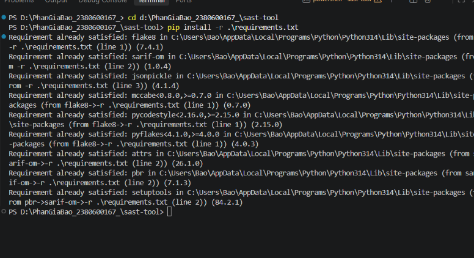

- **Lệnh thực hiện**: `pip install -r .\requirements.txt` (trong thư mục `sast-tool`)
- **Giải thích**: Cài đặt các thư viện phục vụ phân tích mã nguồn tĩnh:
  - `flake8`: Công cụ linter tiêu chuẩn kiểm tra quy chuẩn viết code Python (PEP 8), phát hiện import thừa và lỗi cấu trúc.
  - `sarif-om`: Quản lý mô hình đối tượng báo cáo định dạng chuẩn quốc tế SARIF v2.1.0.
  - `jsonpickle`: Chuyển đổi các đối tượng phân tích thành chuỗi JSON tương thích tiêu chuẩn.

---

### 2. Chạy Unit Test kiểm thử các thành phần SAST
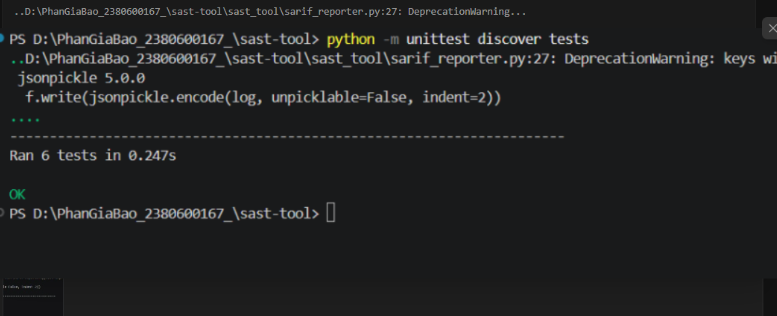

- **Lệnh thực hiện**: `python -m unittest discover tests` (trong thư mục `sast-tool`)
- **Giải thích**: Kiểm thử tự động toàn bộ 5 module chức năng: `ASTAnalyzer`, `VulnPatternMatcher`, `SecurityRuleEngine`, `CodeQualityChecker` và `SarifReporter`. Kết quả `Ran 6 tests ... OK` chứng minh công cụ kiểm thử tĩnh hoạt động chính xác theo logic thiết kế, sẵn sàng quét mã nguồn.

---

### 3. Quét tĩnh phát hiện lỗ hổng trên file `vulnerable_01.py`
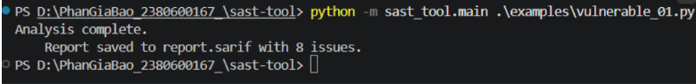

- **Lệnh thực hiện**: `python -m sast_tool.main .\examples\vulnerable_01.py`
- **Giải thích**: Công cụ tự động phân tích và phát hiện chính xác **8 vấn đề** (8 issues) lưu vào file `report.sarif`:
  - **Lỗ hổng AST**: Lệnh gọi hàm `eval(data)` nguy hiểm tại dòng 6.
  - **Lỗ hổng Regex Pattern**: Khai báo mật khẩu dạng chuỗi cứng `password = "123456"` tại dòng 1 và import module `pickle` (tiềm ẩn lỗ hổng Unsafe Deserialization) tại dòng 3.
  - **Lỗi Code Quality (Flake8)**: 5 lỗi vi phạm định dạng chuẩn PEP 8 (import thừa, import không đặt ở đầu file, thiếu dòng trống cách biệt giữa các hàm).

---

### 4. Báo cáo trực quan bằng Extension SARIF Viewer trên VS Code
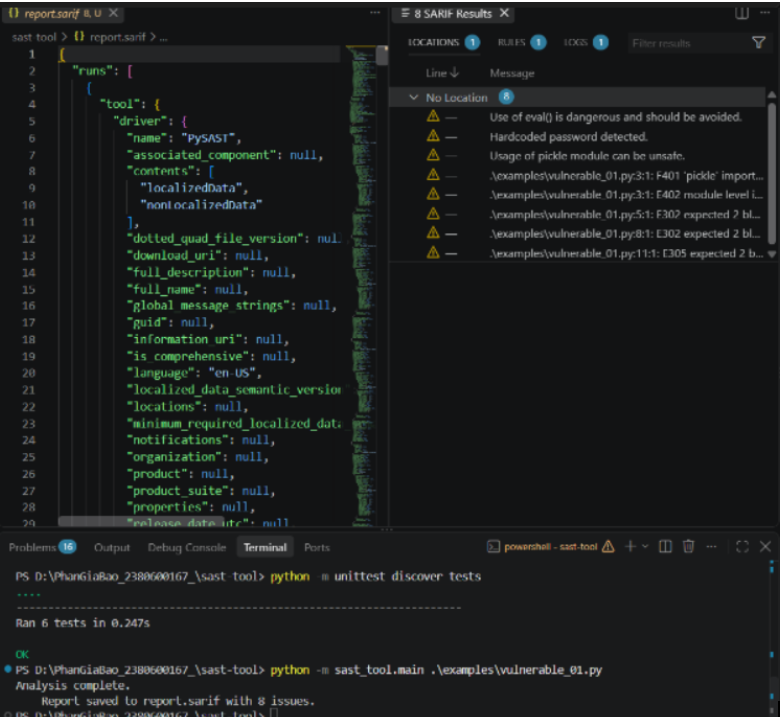

- **Thao tác thực hiện**: Cài đặt extension **SARIF Viewer** (Microsoft DevLabs) trên VS Code và mở file `report.sarif`.
- **Giải thích**: Giao diện tab **SARIF Results** trực quan hóa toàn bộ 8 cảnh báo, phân loại mức độ nghiêm trọng (Warning, Error, Note), hiển thị chính xác vị trí số dòng, số cột của lỗi và thông điệp hướng dẫn giúp lập trình viên nhanh chóng định vị và khắc phục lỗ hổng.

---

### 5. Quét tĩnh phát hiện lỗ hổng trên file `vulnerable_02.py`
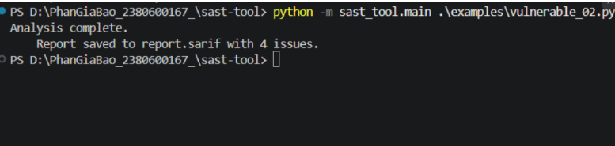

- **Lệnh thực hiện**: `python -m sast_tool.main .\examples\vulnerable_02.py`
- **Giải thích**: Kiểm tra tính mở rộng của công cụ trên một mã nguồn khác. Kết quả phát hiện chính xác **4 vấn đề** (4 issues): 1 lỗ hổng bảo mật nghiêm trọng do sử dụng hàm `eval(user_input)` nhận dữ liệu trực tiếp từ người dùng mà không kiểm duyệt đầu vào (nguy cơ RCE) và 3 vi phạm định dạng mã nguồn Flake8.

---

### 6. Quản lý phiên bản mã nguồn SAST với Git Commit
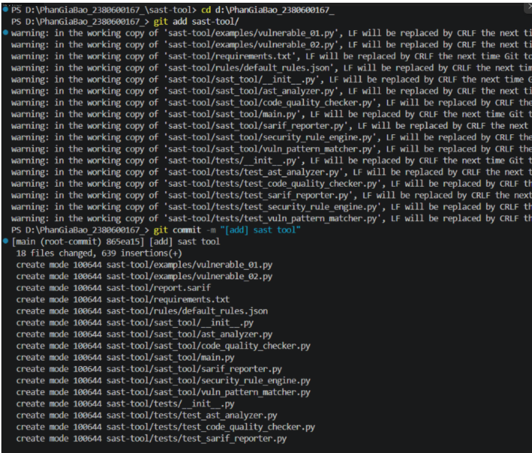

- **Lệnh thực hiện**:
  ```powershell
  git add sast-tool/
  git commit -m "[add] sast tool"
  ```
- **Giải thích**: Lưu vết lịch sử và đóng gói toàn bộ mã nguồn, các bộ quy tắc rule và test cases của module SAST-TOOL vào hệ thống quản lý phiên bản Git theo đúng quy trình DevSecOps.

---

## PHẦN 2: DYNAMIC ANALYSIS SECURITY TESTING (DAST-TOOL)

### 7. Cài đặt các thư viện phụ thuộc cho DAST
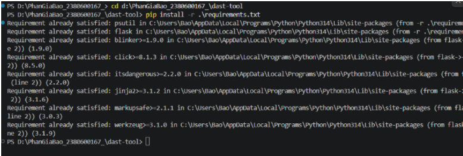

- **Lệnh thực hiện**: `pip install -r .\requirements.txt` (trong thư mục `dast-tool`)
- **Giải thích**: Cài đặt các thư viện phục vụ giám sát thời gian thực:
  - `psutil`: Truy xuất thông tin tầng hệ điều hành (CPU, bộ nhớ RAM, danh sách handle file, card mạng).
  - `flask`: Xây dựng máy chủ Web API phục vụ giám sát và điều khiển DAST từ xa.

---

### 8. Chạy Unit Test kiểm thử các thành phần DAST
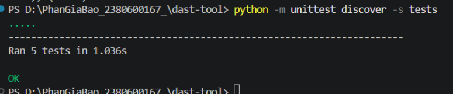

- **Lệnh thực hiện**: `python -m unittest discover -s tests` (trong thư mục `dast-tool`)
- **Giải thích**: Kiểm tra tự động 5 thành phần cốt lõi của DAST: giám sát CPU/RAM (`RuntimeMonitor`), phát hiện tràn số nguyên (`MemoryAnalyzer`), thống kê mạng (`NetworkTrafficAnalyzer`), phát hiện lệnh gọi nguy hiểm (`SecurityBehaviorChecker`) và thực thi an toàn trong môi trường ảo (`VirtualSandbox`). Toàn bộ 5/5 tests đều vượt qua (`OK`).

---

### 9. Thực thi chương trình giám sát động toàn diện `main.py`
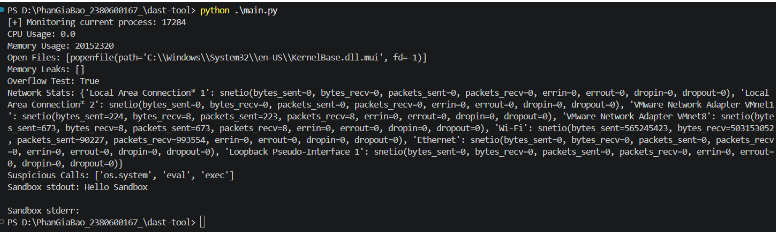

- **Lệnh thực hiện**: `python .\main.py` (trong thư mục `dast-tool`)
- **Giải thích**: Theo dõi hành vi ứng dụng thực tế trong lúc chạy:
  - Giám sát PID của tiến trình, % CPU và dung lượng RAM chiếm dụng.
  - Liệt kê các file/thư viện hệ thống (.dll) mà tiến trình đang mở.
  - Kiểm tra rò rỉ bộ nhớ (Garbage Collection) và kiểm tra tràn số nguyên ($2^{64} > 2^{63}$).
  - Thống kê chi tiết lưu lượng bytes gửi/nhận trên từng card mạng.
  - Nhận diện các system calls nguy hiểm (`os.system`, `eval`, `exec`).
  - Chạy thử lệnh trong môi trường cô lập Virtual Sandbox an toàn.

---

### 10. Khởi chạy máy chủ giám sát Flask API Server
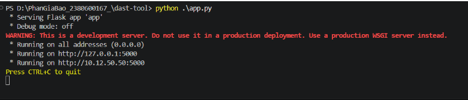

- **Lệnh thực hiện**: `python .\app.py` (trong thư mục `dast-tool`)
- **Giải thích**: Khởi tạo dịch vụ nền tảng DAST dưới dạng Web Service chạy tại cổng 5000 (`http://127.0.0.1:5000`), đóng vai trò như một Security Agent sẵn sàng tiếp nhận các yêu cầu truy vấn giám sát hoặc điều khiển thực thi từ xa.

---

### 11. Kiểm tra kết quả phản hồi của các RESTful API Endpoints
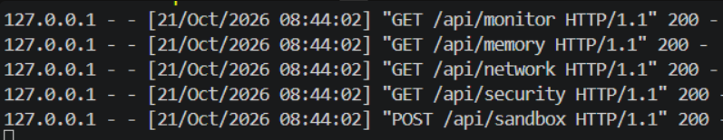

- **Lệnh thực hiện**: `python .\test_api.py` (trong thư mục `dast-tool`)
- **Giải thích**: Kiểm tra sự hoạt động của cả 5 endpoint, tất cả đều trả về mã trạng thái **HTTP 200 (OK)** với dữ liệu định dạng JSON chuẩn:
  - `GET /api/monitor`: Dữ liệu CPU, RAM và danh sách file tiến trình đang mở.
  - `GET /api/memory`: Kết quả kiểm tra rò rỉ bộ nhớ và tràn số nguyên.
  - `GET /api/network`: Dữ liệu bytes và gói tin gửi/nhận của các card mạng.
  - `GET /api/security`: Cảnh báo các lệnh gọi nguy hiểm được phát hiện.
  - `POST /api/sandbox`: Thực thi câu lệnh trong môi trường sandbox và trả về `stdout`/`stderr`.

---

### 12. Quản lý phiên bản mã nguồn DAST với Git Commit
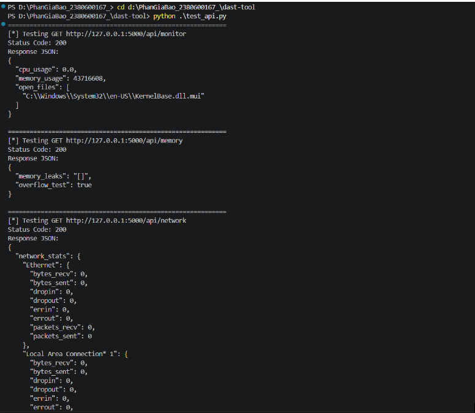

- **Lệnh thực hiện**:
  ```powershell
  git add dast-tool/ README.md .gitignore
  git commit -m "[add] dast tool"
  ```
- **Giải thích**: Đóng gói toàn bộ mã nguồn của công cụ DAST, các bài test và tài liệu báo cáo vào commit Git (`[add] dast tool`), hoàn tất đầy đủ 100% các yêu cầu của bài thực hành số 5.
