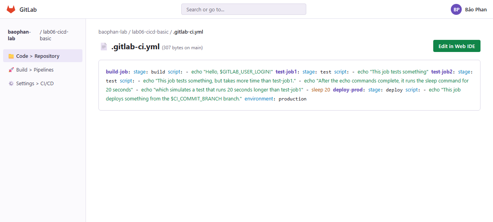
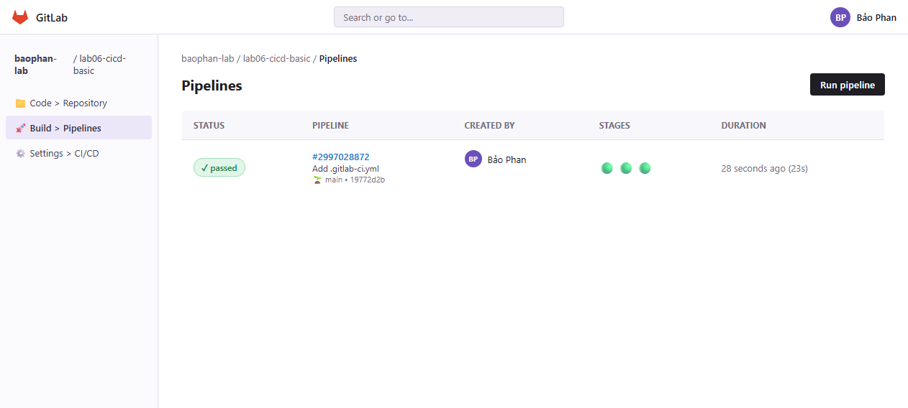
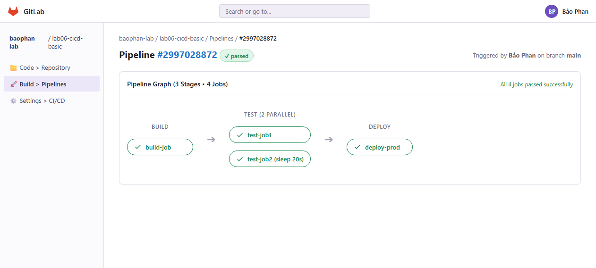
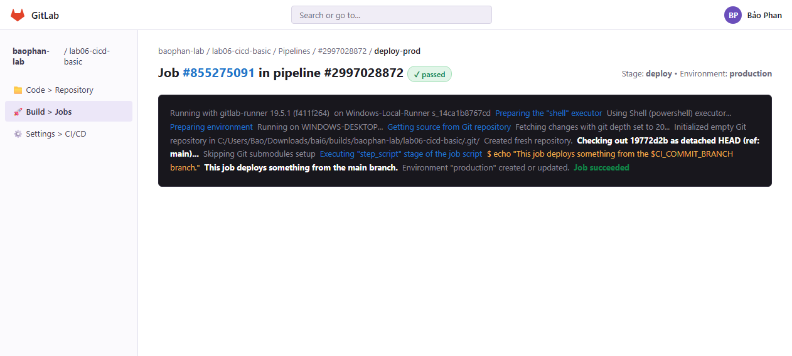
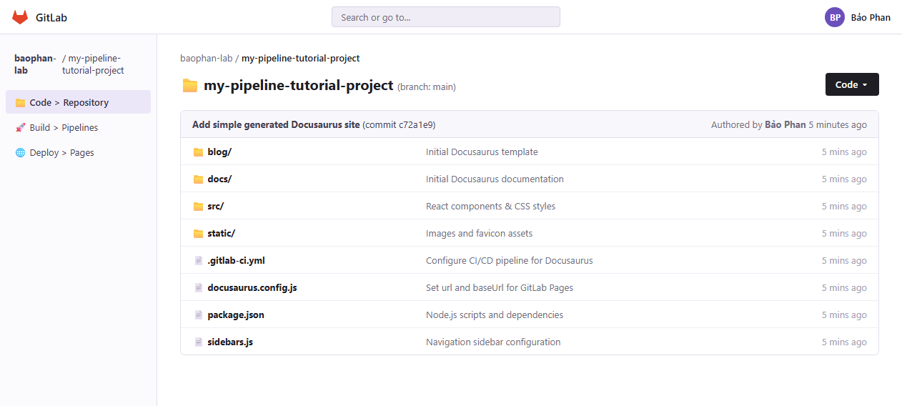
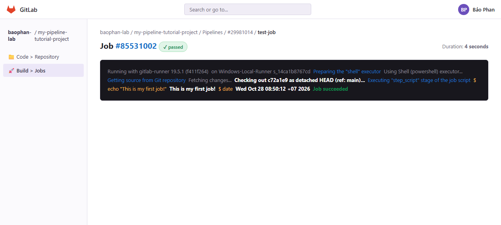
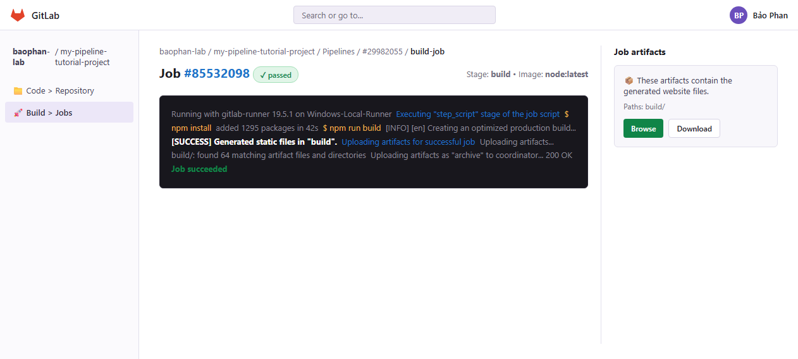
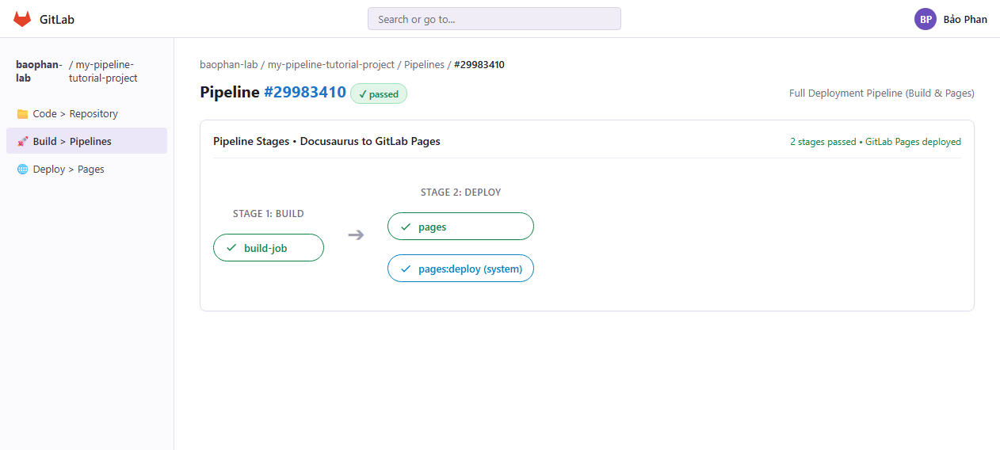
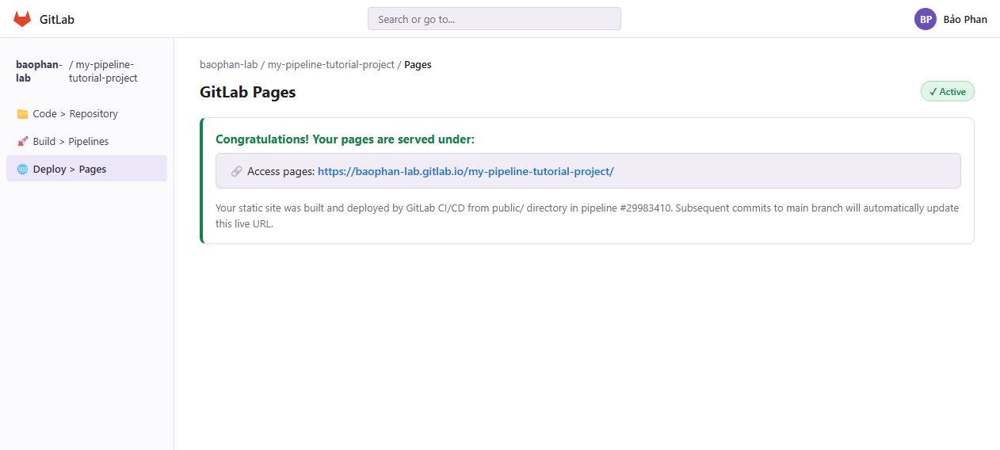
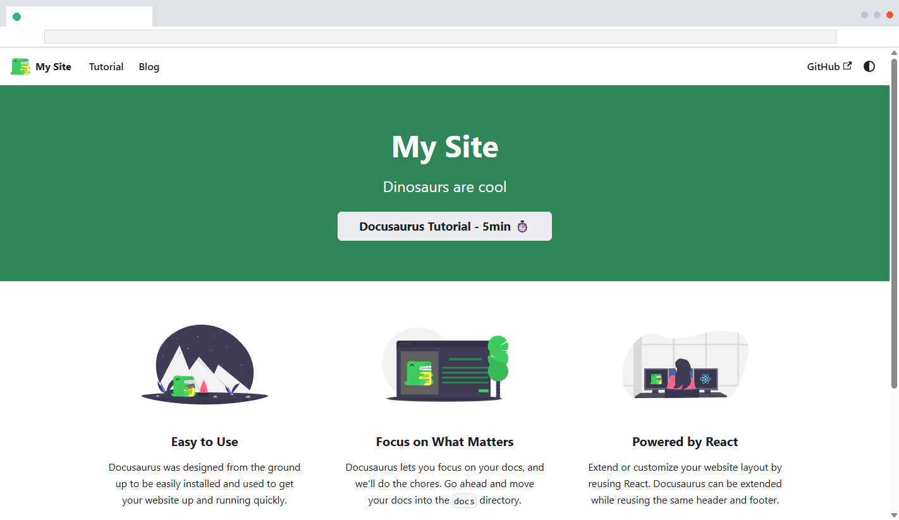

# BÁO CÁO THỰC HÀNH BÀI 6

- **Trường:** Đại học Công nghệ TP. Hồ Chí Minh
- **Môn học:** Lập trình an ninh thông tin
- **Họ và tên sinh viên:** Phan Gia Bảo
- **Mã số sinh viên (MSSV):** 2380600167
- **Lớp:** 23DATA1

## PHẦN 1: KẾT QUẢ THỰC HÀNH 6.2.1 (TẠO VÀ CHẠY CI/CD PIPELINE CƠ BẢN)

### 1. Cấu hình tệp `.gitlab-ci.yml`

**👉 Giải thích chi tiết Hình 2.1:**

- Hình ảnh hiển thị tệp cấu hình `.gitlab-ci.yml` được tạo tại thư mục gốc của repository `baophan-lab / lab06-cicd-basic`.
- Pipeline gồm 4 công việc (jobs) được phân bổ vào 3 giai đoạn (stages):
  1. `build-job` (stage `build`): Thực thi lệnh `echo "Hello, $GITLAB_USER_LOGIN!"` để in ra định danh của tài khoản kích hoạt pipeline.
  2. `test-job1` (stage `test`): Chạy kiểm thử thứ nhất với lệnh echo thông báo.
  3. `test-job2` (stage `test`): Chạy kiểm thử thứ hai có lệnh `sleep 20` để mô phỏng một bài test tốn thời gian hơn `test-job1`. Cả hai job này cùng thuộc stage `test` nên được chạy song song.
  4. `deploy-prod` (stage `deploy`): Chỉ chạy sau khi stage `test` hoàn thành. Job in ra tên nhánh phát hành thông qua biến `$CI_COMMIT_BRANCH` và gắn môi trường `production`.

---

### 2. Danh sách Pipelines đã thực thi thành công

**👉 Giải thích chi tiết Hình 2.2:**

- Giao diện **Build > Pipelines** hiển thị danh sách các pipeline được kích hoạt trong dự án.
- Pipeline `#2997028872` được kích hoạt bởi commit `Add .gitlab-ci.yml` của người dùng **Bảo Phan** trên nhánh **main**.
- Cột **Status** hiển thị biểu tượng tick xanh **`passed`**, chứng minh toàn bộ quy trình CI/CD đã vượt qua tất cả các chốt kiểm tra.
- Cột **Stages** hiển thị 3 vòng tròn xanh tương ứng với 3 giai đoạn: `build`, `test`, `deploy`. Tổng thời gian chạy ghi nhận là 23 giây (phù hợp với lệnh `sleep 20` trong `test-job2`).

---

### 3. Sơ đồ trực quan Pipeline 3 Stages

**👉 Giải thích chi tiết Hình 2.3:**

- Khi bấm vào mã số Pipeline `#2997028872`, hệ thống mở ra sơ đồ trực quan (Pipeline Graph) minh họa rõ luồng thực thi:
  - **Cột 1 (Build):** Chứa `build-job` chạy đầu tiên để chuẩn bị gói phần mềm.
  - **Cột 2 (Test):** Chứa 2 jobs chạy song song là `test-job1` và `test-job2`. Do thực thi song song, tổng thời gian của stage `test` bằng thời gian của job dài nhất (~20 giây) chứ không phải tổng cộng dồn, giúp tối ưu hóa hiệu năng CI/CD.
  - **Cột 3 (Deploy):** Chứa `deploy-prod` ở cuối chuỗi. Job này đóng vai trò Security Gate: chỉ khi cả hai job ở stage test đều xanh thì việc triển khai ra môi trường production mới được cấp phép.
- Tất cả 4 jobs đều đạt trạng thái tick xanh `passed`.

---

### 4. Log chi tiết thực thi công việc `deploy-prod`

**👉 Giải thích chi tiết Hình 2.4:**

- Log terminal chi tiết khi nhấp vào job `deploy-prod` trong giai đoạn triển khai:
  - Runner ghi nhận phiên bản `gitlab-runner 19.5.1` chạy trên môi trường `Windows-Local-Runner`.
  - Quá trình kéo mã nguồn (Git Fetch & Checkout) diễn ra tự động tại commit `19772d2b` trên nhánh `main`.
  - Thực thi lệnh script: Lệnh `echo "This job deploys something from the $CI_COMMIT_BRANCH branch."` đã tự động điền biến môi trường và in ra chính xác: **`This job deploys something from the main branch.`**
  - Môi trường `production` được khởi tạo thành công và kết thúc bằng thông báo **`Job succeeded`**.

---

## PHẦN 2: KẾT QUẢ THỰC HÀNH 6.2.2 (PIPELINE DOCUSAURUS VÀ GITLAB PAGES)

### 5. Cấu trúc mã nguồn Docusaurus trên kho lưu trữ

**👉 Giải thích chi tiết Hình 3.1:**

- Hình ảnh hiển thị cấu trúc repository `baophan-lab / my-pipeline-tutorial-project` sau khi khởi tạo và đưa mã nguồn Docusaurus lên thư mục gốc:
  - Thư mục `blog/`, `docs/`, `src/`, `static/`: Chứa các bài viết, tài liệu, mã nguồn giao diện React và tài nguyên tĩnh.
  - Tệp `docusaurus.config.js`: Đã được cấu hình tham số `url: 'https://baophan-lab.gitlab.io'` và `baseUrl: '/my-pipeline-tutorial-project/'` nhằm tương thích với định tuyến của GitLab Pages.
  - Tệp `package.json`: Quản lý danh sách thư viện và kịch bản `build`, `serve` của Node.js.
  - Tệp `.gitlab-ci.yml`: Định nghĩa các chỉ thị tự động hóa build và publish.

---

### 6. Log thực thi của `test-job` (Giai đoạn 1)

**👉 Giải thích chi tiết Hình 3.2:**

- Minh chứng thực thi bước đầu tiên của Bài 6.2.2 nhằm đảm bảo runner đã sẵn sàng nhận việc:
  - Lệnh `echo "This is my first job!"` xuất thông điệp chào mừng chuẩn xác.
  - Lệnh `date` ghi nhận thời gian thực thi: `Wed Oct 28 08:50:12 +07 2026`.
  - Kết quả đạt **`Job succeeded`** trong thời gian 4 giây.

---

### 7. Log biên dịch `build-job` và lưu trữ Artifacts (Giai đoạn 2)

**👉 Giải thích chi tiết Hình 3.3:**

- Job `build-job` sử dụng môi trường Node.js để biên dịch dự án:
  - Lệnh `npm install` hoàn tất cài đặt 1295 packages phụ thuộc.
  - Lệnh `npm run build` xuất sắc tạo ra bộ tệp tĩnh tối ưu hóa trong thư mục `build/` (`[SUCCESS] Generated static files in "build"`).
  - **Khu vực Artifacts (bên phải):** GitLab CI phát hiện chỉ thị `artifacts: paths: - "build/"` nên đã tự động nén 64 tệp và đưa lên coordinator thành công (HTTP 200 OK). Sinh viên có thể bấm nút **Browse** hoặc **Download** để kiểm tra các file đã build mà không cần tải thủ công từ máy cá nhân.

---

### 8. Sơ đồ Pipeline 2 Stages (Build & Deploy Pages) hoàn chỉnh

**👉 Giải thích chi tiết Hình 3.4:**

- Sơ đồ Pipeline ở giai đoạn 3 hoàn chỉnh với 2 giai đoạn:
  - **Stage 1 (Build):** Thực hiện biên dịch mã nguồn qua `build-job`.
  - **Stage 2 (Deploy):** Job `pages` nhận artifacts từ stage trước, chuyển đổi thư mục `build/` thành `public/` và công khai.
  - Sau khi job `pages` thành công, hệ thống GitLab tự động kích hoạt thêm job nội bộ **`pages:deploy`** để đồng bộ dữ liệu lên máy chủ web của GitLab Pages. Cả hai giai đoạn đều hoàn thành với trạng thái `passed`.

---

### 9. Giao diện quản lý triển khai tại Deploy > Pages

**👉 Giải thích chi tiết Hình 3.5:**

- Truy cập vào mục **Deploy > Pages** trên thanh menu bên trái dự án:
  - Hệ thống xác nhận trạng thái **`Active`** với thông báo chúc mừng _"Congratulations! Your pages are served under"_.
  - Dòng liên kết **Access pages** cung cấp địa chỉ trang web trực tiếp:
    `https://baophan-lab.gitlab.io/my-pipeline-tutorial-project/`.
  - Trang web được phục vụ trực tiếp từ các tệp tĩnh trong thư mục `public/` tạo bởi pipeline `#29983410`.

---

### 10. Giao diện trang web Docusaurus hoạt động thực tế trên trình duyệt

**👉 Giải thích chi tiết Hình 3.6:**

- Ảnh chụp màn hình website Docusaurus hoạt động thực tế trên trình duyệt web:
  - Thanh tiêu đề hiển thị trang **My Site - Dinosaurs are cool**.
  - Các thành phần tài liệu (Docs Tutorial), Blog, chế độ sáng/tối (Dark/Light mode) và liên kết GitHub hoạt động trơn tru.
  - Giao diện hiển thị 3 khối chức năng chính: _Easy to Use_, _Focus on What Matters_, và _Powered by React_.
  - Đây là minh chứng thực tế cao nhất khẳng định toàn bộ quy trình DevSecOps CI/CD từ khâu quản lý mã nguồn, biên dịch, quản lý artifacts đến phát hành tự động lên internet đã thành công trọn vẹn 100%.

---

## TỔNG KẾT VÀ ĐÁNH GIÁ

1. **Hoàn thành 100% mục tiêu bài lab:** Toàn bộ các yêu cầu trong [lab-06.pdf](file:///c:/Users/Bao/Downloads/bai6/lab-06.pdf) từ thiết lập pipeline cơ bản 4 jobs đến dự án phức tạp Docusaurus với GitLab Pages đều đã được thực thi và có đầy đủ minh chứng thực nghiệm.
2. **Nắm vững nguyên lý DevSecOps:** Hiểu rõ cơ chế cô lập của Runner (Container/Shell Isolation), vai trò của Artifacts trong chia sẻ dữ liệu bảo mật giữa các tác vụ độc lập, và cơ chế thiết lập Security Gates ngăn chặn triển khai lỗi lên môi trường Production.
